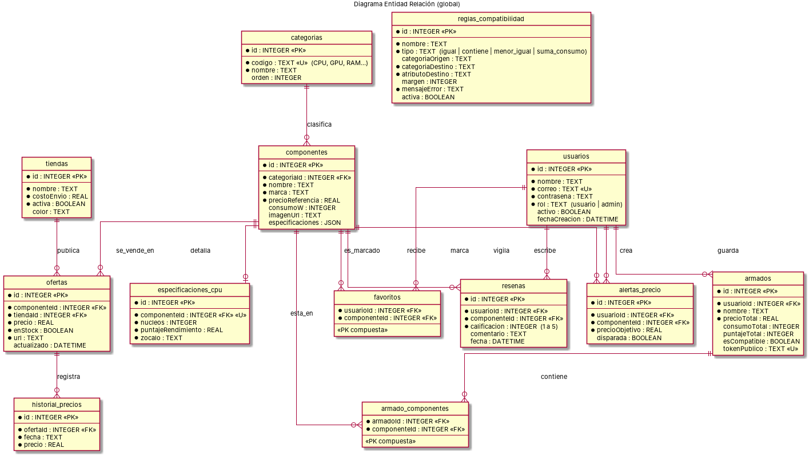
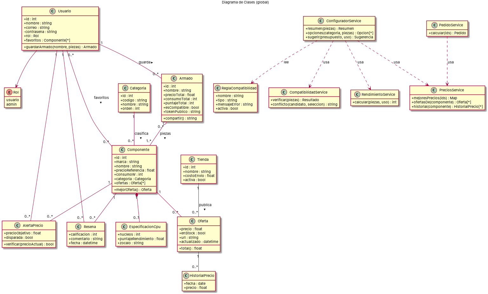
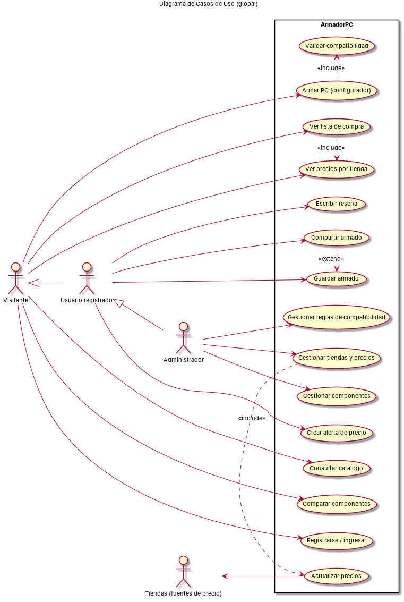
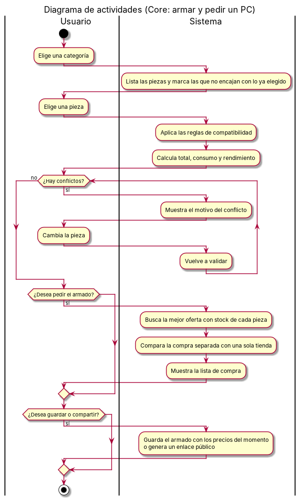
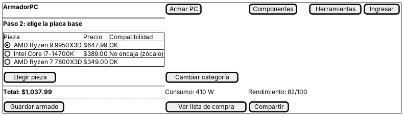
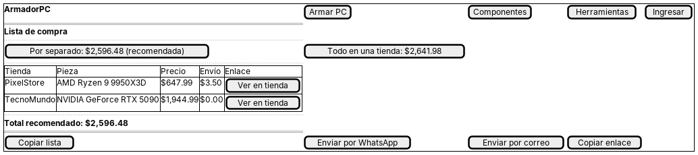

# 1. Descripción del proyecto

ArmadorPC es una aplicación web que ayuda a una persona a armar una computadora de escritorio que funcione bien y a comprar sus piezas al mejor precio. Hoy esto es difícil por tres razones: las piezas pueden ser incompatibles entre sí (por ejemplo, un procesador con un zócalo que no coincide con la placa base, o una fuente que no alcanza para la tarjeta gráfica), los precios cambian constantemente y están repartidos entre varias tiendas, y no es fácil saber si conviene comprar todo en una sola tienda o por separado.

El sistema reúne en un solo lugar el catálogo de componentes, los precios de tiendas de Ecuador, un configurador que valida la compatibilidad en tiempo real y una lista de compra que indica dónde comprar cada pieza.

Participan tres tipos de usuario:

- **Visitante:** consulta el catálogo, compara componentes, arma un PC en el configurador y obtiene su lista de compra sin necesidad de registrarse.
- **Usuario registrado:** además guarda sus armados, comparte un enlace público, crea alertas de precio, marca favoritos y escribe reseñas.
- **Administrador:** gestiona componentes, categorías, reglas de compatibilidad, tiendas y reportes de datos incorrectos.

El proyecto se desarrolla con el patrón **MVC**:

| Capa | Tecnología | Responsabilidad en ArmadorPC |
|---|---|---|
| **Modelo** | NestJS + TypeORM + SQLite | Entidades (tablas) y servicios con las reglas de negocio: compatibilidad, rendimiento, precios y pedidos. |
| **Controlador** | Controladores de NestJS (`/api/...`) | Reciben cada petición, validan los datos con DTOs y devuelven JSON. |
| **Vista** | HTML, CSS y JavaScript (Vite) | Páginas que consumen la API con `fetch` y muestran la información al usuario. |

# 2. Explicación del Core propuesto

El Core del sistema es el **configurador de armado**. Es la parte que resuelve el problema principal: entregar un equipo compatible, con su precio real y con la mejor forma de comprarlo. Está formado por cuatro procesos que trabajan juntos.

## 2.1 Validación de compatibilidad

Las reglas de compatibilidad se guardan en la tabla `reglas_compatibilidad`, no dentro del código. Cada regla compara un atributo de una pieza con el de otra. El motor soporta cuatro tipos de regla:

| Tipo | Significado | Ejemplo |
|---|---|---|
| `igual` | El atributo de origen debe ser igual al de destino. | El zócalo del procesador debe ser igual al de la placa base. |
| `contiene` | El valor debe estar en una lista de valores admitidos. | El tipo de memoria RAM debe estar entre DDR4 y DDR5 admitidos por la placa. |
| `menor_igual` | El valor de origen no puede superar al de destino. | La longitud de la tarjeta gráfica debe caber en la caja. |
| `suma_consumo` | La potencia de la fuente debe cubrir el consumo de todas las piezas más un margen. | Fuente de 650 W para un equipo que consume 480 W con 20 % de margen. |

Cuando una regla no se cumple, el sistema muestra el mensaje de error guardado en la regla. Si faltan piezas para evaluarla, la regla se omite y se indica al usuario. Para agregar una regla nueva basta con insertar un registro en la base de datos.

## 2.2 Rendimiento estimado

Cada pieza tiene un puntaje de rendimiento. Con ellos se calcula un puntaje general de 0 a 100 según el uso del equipo, dando más peso a la pieza que más influye en esa actividad:

- **Juegos:** tarjeta gráfica 65 %, procesador 25 % y memoria RAM 10 %.
- **Trabajo y creación:** procesador 60 %, tarjeta gráfica 25 % y memoria RAM 15 %.

Con este puntaje el sistema también identifica un posible cuello de botella (por ejemplo, un procesador demasiado débil para la tarjeta gráfica elegida).

## 2.3 Precios por tienda

El precio de cada pieza se obtiene de las ofertas que las tiendas publican:

1. Se consultan tiendas de Ecuador (en el modo real) mediante sus APIs públicas, y se toman los datos de precio, stock y enlace. Las tiendas que funcionan con WooCommerce, como NomadaWare, se consultan por su API pública de productos; cada oferta enlaza a la página del producto en la tienda, de modo que el usuario compra allí.
2. Un **emparejador** decide si el producto de la tienda es realmente el mismo modelo del catálogo. Revisa números de modelo, sufijos (como Ti, XT o X3D), palabras excluidas (por ejemplo "laptop"), la marca y que el precio esté dentro de un rango razonable. Así, "RX 9070" no se confunde con "RX 9070 XT".
3. Si una tienda publica precios "+ IVA", se suma el 15 % para comparar lo mismo.
4. Se conserva el precio más bajo con stock de cada pieza. Si ninguna tienda responde, se usa el precio de referencia del catálogo y el sistema lo indica.
5. Cada día se guarda el historial del precio, con el que se dibuja la gráfica de 90 días y se avisa al usuario cuando un precio baja de su objetivo.

## 2.4 Lista de compra

La lista de compra responde a la pregunta "¿dónde compro cada pieza?". Calcula dos opciones y recomienda la más barata:

- **Por separado:** cada pieza en la tienda que la vende más barata. Se suma el envío una sola vez por tienda.
- **Todo en una tienda:** una sola tienda que tenga todas las piezas en stock. Se suma su envío.

La lista se abre en una página propia que toma las piezas del enlace o del armado guardado en el equipo (Mi PC), y no requiere iniciar sesión. Con esto el usuario ve, por ejemplo, que comprar todo en una tienda cuesta $2,641.98 y por separado $2,596.48, y que por separado es lo más barato. El sistema también avisa si alguna pieza no tiene precio o no tiene stock.

## 2.5 Guardar y compartir el armado

Un usuario registrado puede guardar su armado. El sistema guarda el precio, el consumo y el puntaje del momento, de modo que después pueda mostrar si el precio subió o bajó. Cualquier armado guardado puede compartirse con un **enlace público** que muestra el equipo, el precio guardado, el precio de hoy y la diferencia, sin revelar datos del dueño. El enlace usa un código aleatorio que se genera una sola vez por armado, por lo que no puede adivinarse. El dueño puede abrir la lista de compra del mismo armado desde el enlace.

# 3. Alcance del Core

## 3.1 Qué hace el Core

El Core cubre la funcionalidad de armado, validación, precios y pedido. Específicamente:

- Mostrar el catálogo de componentes por categoría con filtros de marca, gama, precio y stock.
- Permitir elegir una pieza por categoría, marcando las que no encajan con lo ya elegido.
- Validar la compatibilidad del armado con las reglas activas, y mostrar los motivos de cada conflicto.
- Calcular el precio total, el consumo estimado y el rendimiento del equipo.
- Sugerir un armado automático a partir de un presupuesto y un uso (juegos o trabajo).
- Mostrar el precio de cada pieza por tienda y su historial.
- Generar la lista de compra con la mejor forma de comprar, y permitir copiarla, enviarla por WhatsApp o por correo.
- Guardar armados (usuarios registrados) y compartirlos mediante un enlace público.
- Mostrar los productos de la tienda NomadaWare (accesorios y componentes de PC) con foto, precio y enlace a la tienda. Estos productos se muestran en la página de accesorios y dentro del selector de piezas, pero no se agregan al armado, porque no tienen ficha técnica para validar la compatibilidad.
- Actualizar los precios automáticamente, y permitir al administrador gestionar componentes, reglas y tiendas.

## 3.2 Qué queda fuera del Core

- Procesamiento de pagos y compra directa dentro de la aplicación. El usuario compra en la tienda, no en ArmadorPC.
- Venta de productos propios o gestión de inventario de las tiendas.
- Integración con Amazon, porque su API de precios se discontinúa en 2026 y su reemplazo exige una cuenta de afiliado aprobada.
- Envío de correos desde el servidor. La lista se envía desde el correo o WhatsApp del propio usuario.

## 3.3 Actores del Core

| Actor | Tipo | Participación en el Core |
|---|---|---|
| Visitante | Principal | Arma PC, consulta precios y obtiene la lista de compra. |
| Usuario registrado | Principal | Además guarda armados, los comparte y crea alertas. |
| Administrador | Principal | Gestiona componentes, reglas de compatibilidad y tiendas. |
| Tiendas (fuentes de precio) | Secundario | Publican precios y stock que el sistema consulta. |

## 3.4 Requisitos funcionales del Core

| Código | Requisito |
|---|---|
| RF01 | El sistema muestra los componentes de una categoría con filtros y orden. |
| RF02 | El sistema muestra el precio por tienda de cada componente, con stock e historial. |
| RF03 | El configurador lista las piezas de una categoría y marca las incompatibles con lo ya elegido. |
| RF04 | El sistema valida el armado con las reglas activas y explica cada conflicto. |
| RF05 | El sistema calcula el precio total, el consumo y el rendimiento del armado. |
| RF06 | El sistema arma un equipo automático según presupuesto y uso. |
| RF07 | El sistema genera la lista de compra con la opción más barata (por separado o en una tienda). |
| RF08 | Un usuario registrado guarda su armado y genera un enlace público para compartirlo. |
| RF09 | El administrador crea, modifica y elimina componentes, categorías, reglas y tiendas. |
| RF10 | El sistema actualiza los precios de forma automática cada cierto tiempo. |
| RF11 | El sistema permite registrarse, ingresar y salir, y limita los intentos fallidos de ingreso. |
| RF12 | El sistema muestra los productos de tiendas externas (NomadaWare) con foto, precio, stock y enlace a la tienda, leyendo todas las páginas del catálogo. |
| RF13 | El sistema muestra la lista de compra de un armado en una página propia, con opciones para copiarla, enviarla por WhatsApp o por correo. |

## 3.5 Requisitos no funcionales

- **Seguridad:** contraseñas cifradas con bcrypt; sesión con JWT guardado en una cookie HttpOnly; los armados guardados solo los ve su dueño o un administrador.
- **Validación:** todos los datos de entrada se validan con DTOs y los errores se devuelven con un formato uniforme.
- **Disponibilidad:** si una tienda no responde, el sistema sigue funcionando con los últimos precios o con el precio de referencia.
- **Usabilidad:** la aplicación se adapta a pantallas de teléfono, sin desplazamiento horizontal.
- **Mantenibilidad:** las reglas de compatibilidad y las tiendas se administran en la base de datos, sin modificar el código.

## 3.6 Avance de la implementación

| Módulo | Estado |
|---|---|
| Configurador, validación de compatibilidad y rendimiento | Implementado y probado |
| Precios por tienda (modo demostración y modo real) | Implementado; el modo real depende de la conexión con cada tienda |
| Lista de compra (por separado y en una tienda) | Implementado y probado |
| Guardar y compartir armado | Implementado y probado |
| Productos de NomadaWare (página de accesorios y selector) | Implementado; el catálogo completo se carga con el script de lectura de la tienda |

# 4. Diagramas

## 4.1 Diagrama Entidad Relación (global)

El diagrama muestra las 13 tablas del núcleo, de las 17 que tiene la base de datos SQLite (las demás son de comunidad, guías y configuraciones). `categorias` agrupa los componentes; `componentes` es la entidad central, a la que se conectan las ofertas, las alertas, las reseñas y los armados. `armado_componentes` y `favoritos` son tablas intermedias de relación muchos a muchos. Las reglas de compatibilidad referencian categorías por su código.

## 4.2 Diagrama de Clases (global)

Las entidades representan los datos. Los servicios (`ConfiguradorService`, `CompatibilidadService`, `RendimientoService`, `PreciosService` y `PedidoService`) concentran las reglas de negocio y son usados por los controladores. Así, la lógica de compatibilidad y de precios no depende de la interfaz.

## 4.3 Diagrama Casos de uso (global)

El diagrama muestra el acceso por tipo de usuario. El Visitante puede armar un PC y obtener su lista de compra. El Usuario registrado añade guardar, compartir, alertas y reseñas. El Administrador gestiona el catálogo, las reglas y las tiendas. "Armar PC" incluye la validación de compatibilidad, y "Ver lista de compra" incluye la consulta de precios por tienda.

## 4.4 Diagrama de actividades (Core)

El flujo inicia cuando el usuario elige una categoría. El sistema muestra las piezas y marca las que no encajan. Después de cada elección se valida la compatibilidad: si hay conflictos, el usuario cambia la pieza y el sistema vuelve a validar. Cuando el armado es válido, el usuario puede pedir la lista de compra y, opcionalmente, guardar o compartir el armado.

## 4.5 Wireframes (Core)

Los siguientes bocetos muestran la distribución de las dos pantallas principales del Core. Son diseños de baja fidelidad para definir la estructura antes de programar.

**Configurador.** El usuario elige una pieza de la lista, ve si es compatible y el total del armado en tiempo real. Los botones de la parte inferior permiten guardar, ver la lista de compra o compartir.

**Lista de compra.** Se presentan las dos opciones de compra, la recomendada y el detalle por tienda con el enlace a cada producto. Un bloque final permite copiar o enviar la lista.

